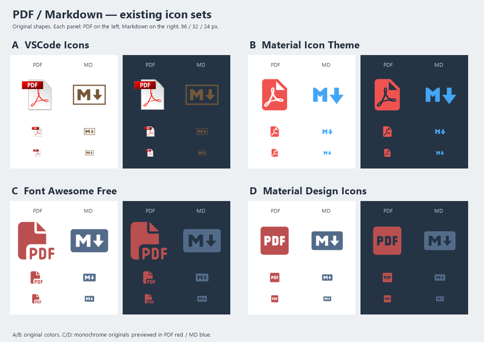

# PDF / Markdown existing icon candidates

用户已选 PDF B / MD D，并追加要求统一饱和度。选定资产已接入 Reader，共用母版增加内部不透明白色填充，配色 PDF #b45c5c / MD #5c83b4（同饱和度 36.97%、明度 53.33%）。下图保留选型时的原图/原色，正式安装与视觉状态见 docs/STATUS.md。

每组左 PDF、右 Markdown；白底/深灰蓝底分别展示 96 / 32 / 24px 画布。A/B 保留上游颜色；C/D 原为单色，只在预览的外层 SVG 设置 PDF 红色、MD 蓝色。原路径、渐变、镂空和内部留白均保留；透明区域按原图显示，未添加白色填充。尺寸是预览画布，不是已经认可的最终应用占比。

| ID | Source | Selected assets | Icon license |
| --- | --- | --- | --- |
| A | [VSCode Icons](https://github.com/vscode-icons/vscode-icons) | file_type_pdf / file_type_markdown | Icons CC BY-SA 4.0; branded marks subject to their copyright terms. Repository code LICENSE is MIT and does not replace the icon terms. |
| B | [Material Icon Theme](https://github.com/material-extensions/vscode-material-icon-theme) | pdf / markdown | MIT |
| C | [Font Awesome Free 6.7.2](https://github.com/FortAwesome/Font-Awesome/tree/6.7.2) | solid/file-pdf / brands/markdown | SVG icons CC BY 4.0 |
| D | [Material Design Icons](https://github.com/Templarian/MaterialDesign-SVG) | file-pdf-box / language-markdown | Pictogrammers icon terms: Apache 2.0, with redistributed-icon exceptions described in the original notice |

固定提交、原始 URL 和 SHA256 见 [sources.json](sources.json)；原始文件和许可见 `sources/`，A 的图标许可声明同时保存在上游 README 快照。选定后按对应许可保留署名/notice，并按用户要求处理不透明填充；软件 Fluent 图标及认可的列表/标签/Windows 尺寸保持。

复现：从仓库根运行 `powershell -ExecutionPolicy Bypass -File design/icon-options/2026-10-07/render-preview.ps1`。使用现有 Node/Tauri CLI 和 .NET System.Drawing；无新增依赖。脚本核对全部清单文件哈希、解析八个 SVG、调用原生渲染器、生成 `comparison.png` 和 [verification.json](verification.json)。未运行桌面自动化或截图。
